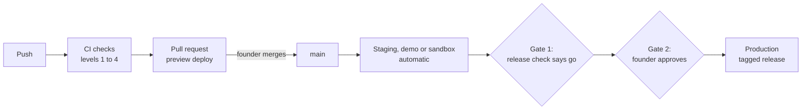

<!-- Source of the handbook. The Claude Docs view is generated from this file by publish-views. Edit here. -->
# Startup Operating System: Zero to Scale

## What the system is

One version-controlled system runs the startup from first idea to scale. Claude reasons, the repository remembers, and the founder decides.

| Component | Role | Holds |
| --- | --- | --- |
| Claude Project | Management and reasoning: strategy, discovery, product, architecture decisions, reviews | Instructions plus 8 knowledge files, nothing else |
| GitHub repository | Source of truth | Approved docs, specs, decisions, status, code, tests, history |
| Claude Code | Technical execution: build, test, refactor, maintain docs | Short sessions, one story group each |
| Artifacts | Live views for reading and sharing | Generated from the repo, never edited as the source |

**Five rules hold everything together:**

1. **The repo is the memory.** If a decision isn't in the repo, it doesn't exist. Chats can be thrown away once their decisions are saved.
2. **Nothing becomes Approved without the founder's words.** Everything else stays Proposed, Assumption or Open.
3. **Merging a pull request is approval.** An open PR means Proposed; once merged, it's Approved.
4. **One copy of each thing.** The protocol, the tokens and each requirement live in one file; everything else points to it. This handbook is a view too: its source is docs/handbook.md in the solo-to-scale plugin repo.
5. **Prototype is not production.** Every stage has a gate, and going live has its own gates.

## Day 0 setup

Setup takes about an hour and one Claude Code session, once per startup.

- [ ] **Account plugins:** founder, Superpowers, marketing, and brand-skills (added as a marketplace from `cofoundy/brand-skills`)
- [ ] **GitHub repository** created, private, default branch `main`
- [ ] **Install the solo-to-scale plugin and run its `init` skill** in a Claude Code session named `<Project> · OPS Operating system`, using a mid-tier model
- [ ] **Install repo skills** during init:
  - Spec Kit (`.claude/skills/speckit-*`)
  - brand-skills (`npx skills add cofoundy/brand-skills`)
  - Superpowers and founder enabled in `.claude/settings.json`
- [ ] **Review and merge the init PR.** That merge approves the protocol.
- [ ] **Create the Claude Project:**
  - paste `founder/claude-project/instructions.md`
  - add the 8 knowledge files listed in `knowledge.md` from GitHub
- [ ] **Create the Monday scheduled task** from `founder/claude-project/weekly-review-task.md`: weekly review, then refresh the views
- [ ] **Check the hooks** in the first Claude Code session: the HANDOFF summary appears and the status line shows context %
- [ ] **Add secrets** to GitHub (API keys, denylists) as `status.md` lists them. Never commit them.

## Repository map

Each kind of information has exactly one home. If something seems to belong in two places, one of them becomes a link.

| Path | Holds | Updated by |
| --- | --- | --- |
| `CLAUDE.md` | Imports AGENTS.md, the instructions shared by Claude and Codex: standing rules, invariants, stack, commands, model choice. The two together stay under 200 lines | Founder approval only |
| `HANDOFF.md` | Build state, next story groups, known gaps, where to start | `handoff` skill |
| `founder/operating-protocol.md` | The protocol: the only copy | Founder approval only |
| `founder/status.md` | Objectives, stage, risks, founder items, weekly focus | `handoff`, `weekly-review` |
| `founder/decisions.md` | Business register (`B-`): GTM, pricing, brand, legal, hiring | `record-decision` |
| `founder/business-context.md` | Problem, customer, evidence, model, positioning, regulation | Discovery chats |
| `founder/brand.md` | Name, positioning line, voice, wording rules | brand-skills |
| `founder/playbook.md` | This journey's stage-gate table with the current stage marked | `weekly-review` |
| `founder/artifacts.md` | Registry of live views: ID, type, sources, last published commit | `publish-views` |
| `founder/sources/` | Original source documents | Founder |
| `founder/claude-project/` | Project instructions, knowledge list, scheduled-task prompts | Bootstrap |
| `specs/<NNN-feature>/` | Spec Kit: `spec.md`, requirements, plan, data model, contracts, tasks, product register (`D-`), `ux/<screen>.md` | Spec Kit, `product-design` |
| `design/tokens.json` | Design tokens: the only source; CSS and theme files generated from it | `design-system` |
| `docs/design-system/` | Principles, token roles, component index, patterns | `design-system` |
| `docs/` | Public product docs | Build sessions |
| `apps/`, `tests/` | Code and tests | Build sessions |
| `.claude/` | Skills, hooks, `governance.json`, `settings.json` | Founder-approved PRs |
| `tools/` | Generators and checks: governance, roadmap `--json`, tokens | Build sessions |

Two more homes: founder/team.md holds the roles, epic ownership, advisor routing and role budgets, and every generator reads its mapping from there; founder/board/ holds the advisors' memos. Plugins that save into `founder/` (founder, brand-skills) must never overwrite `status.md`, `decisions.md` or `business-context.md`. Changes to those go through the skills.

## The journey: zero to scale

The journey runs through 7 phases and 30 stages, each ending in a gate. Inside the build stages (13 to 17), work ships in slices: shippable increments, each with an exit check. A slice is built in story groups, one per session. So: phase (A to G), then stage (1 to 30), then slice, then story group. A stage starts only when the previous gate is passed or explicitly deferred. Learning from later stages flows back to earlier ones through `record-decision`.

**Where:** P = a Claude Project chat with that prefix; Code = a Claude Code session; Task = a scheduled task.

```mermaid
flowchart LR
  A["A. Discover<br/>stages 1-2"] -->|"gate: pain confirmed"| B["B. Define<br/>stages 3-7"]
  B -->|"gate: MVP scope approved"| C["C. Specify and design<br/>stages 8-12"]
  C -->|"gate: no contradictions"| D["D. Build and prove<br/>stages 13-17, in slices"]
  D -->|"gate: release check says go"| E["E. Launch<br/>stages 18-22"]
  E -->|"gate: go-live decision"| F["F. Grow to product-market fit<br/>stages 23-25"]
  F -->|"gate: retention and conversion targets"| G["G. Scale<br/>stages 26-30"]
  G -->|"gate: governance cadence running"| H(("Scale"))
```

Each phase's gate must pass before the next phase starts. The stage table below gives the detail for every stage.

| # | Stage | Where | Main skills | Output | Gate |
| --- | --- | --- | --- | --- | --- |
| **A** | **Discover** |  |  |  |  |
| 1 | Problem validation | P 01 | founder: validate-idea, competitor-matrix | `business-context.md`: problem, evidence | Pain confirmed by evidence, not assumption |
| 2 | Customer discovery | P 01 | founder: user-interviews, persona-gen | Interview notes and findings, personas | 5 to 8 interviews show pain and willingness to pay |
| **B** | **Define** |  |  |  |  |
| 3 | Business model and positioning | P 01 | founder: pricing-strategy; marketing: competitive-brief | `B-` decisions | Founder approves |
| 4 | Brand strategy | P 06 | brand-skills: naming, brand-architecture | `brand.md`, `B-` decisions | Name, trademark and domain checked |
| 5 | Product and operating model | P 02 | founder: product-brief | Product definition, operating model | Founder approves |
| 6 | UX prototype and test | P 02, Code | product-design, Claude Design | Key journeys, clickable prototype | Tested with 3 to 5 target users |
| 7 | MVP scope and launch criteria | P 02 | founder: mvp-scope | Must / Should / Won't, launch criteria | Founder approves scope |
| **C** | **Specify and design** |  |  |  |  |
| 8 | Specify | Code | Spec Kit: specify, clarify, checklist | `spec.md`, requirements, stories, journeys; open items | Every open item answered or deferred |
| 9 | Screen specs | Code | product-design | `specs/*/ux/<screen>.md` with states and acceptance criteria | Criteria linked to stories |
| 10 | Plan the system | Code, P 03 | Spec Kit: plan, constitution; Superpowers: brainstorming | Stack, architecture, data model, contracts, security, invariants, CI/CD and environments | Founder approves architecture, threat model and Well-Architected review |
| 11 | Design system | Code | design-system, brand-skills: brand-identity | `tokens.json`, components, `docs/design-system/` | Founder approves foundations |
| 12 | Tasks and story groups | Code | Spec Kit: tasks, analyze | `tasks.md`, slices, story groups | `analyze` finds no contradictions |
| **D** | **Build and prove** |  |  |  |  |
| 13 | Build, one session per story group | Code 04 | Superpowers: writing-plans, test-driven-development, systematic-debugging, requesting-code-review | Code, tests, evidence | Definition of done met |
| 14 | Test at 5 levels | CI, founder | verification-before-completion | CI results, eval report | All levels pass |
| 15 | Integrate continuously | GitHub | finishing-a-development-branch | PR into `main` | Founder merges |
| 16 | Deploy continuously, to non-production | CI | (pipeline) | Every merge deployed to preview and staging | Test data only; dependencies pinned, builds signed |
| 17 | Release check | P 05, Code | release-check | Go / no-go | Go |
| **E** | **Launch** |  |  |  |  |
| 18 | Demo and website | Code, P 06 | founder: landing-page; marketing: brand-review | Demo instance, public site | Honesty checklist signed |
| 19 | Sandbox or beta | Code | (build) | Self-serve access with test data | External user completes the core flow |
| 20 | Design partners | P 06 | founder: go-to-market | Shadow runs or pilots on partner data | Partner confirms value |
| 21 | Production readiness | P 05, Code | release-check, security review | Security test, legal terms, service targets and error budget, alerts, restore and load tests, AI spending caps, runbooks, incident process | All readiness items closed |
| 22 | General availability | P 00 | founder: pitch-deck (announce) | Live product, pricing on | Founder go-live decision |
| **F** | **Grow to product-market fit** |  |  |  |  |
| 23 | Measure | P 00, Task | founder: metrics-dashboard | Metrics dashboard view | 5 stage metrics tracked weekly |
| 24 | Iterate | P 01, P 06 | founder: pricing-strategy, email-sequence; marketing: campaign-plan | `B-` and `D-` changes | Retention and conversion hit targets |
| 25 | Fundraise | P 00 | founder: fundraise-prep, pitch-deck | Deck, data room from repo views | Round closed or deferred |
| **G** | **Scale** |  |  |  |  |
| 26 | Team and ownership | P 00 | (process) | `CODEOWNERS`, reviewers, onboarding from repo | Every area has a human owner |
| 27 | Operations | Code, P 05 | systematic-debugging | Error-budget reviews, on-call, blameless postmortems, unit-cost tracking | Targets met for a quarter |
| 28 | Compliance and certifications | P 03, P 05 | (advisors) | Controls mapped to repo evidence | Audit passed |
| 29 | Platform and new products | Code, P 03 | Spec Kit: new `specs/NNN-*` | Architecture review, new feature specs | Architecture approved |
| 30 | Governance cadence | P 00, Task | weekly-review | Monthly and quarterly reviews, board pack | Cadence running |

## Operating rhythm

Four loops keep the system current. Only the session loop needs you every day.

| Loop | When | What happens | Your part |
| --- | --- | --- | --- |
| Session | Each story group or task | Start from `HANDOFF.md` → plan → tests first → build → checks → handoff → PR | Answer questions, merge the PR |
| Weekly | Monday, scheduled task | Weekly review with the five DORA metrics (stops early if nothing changed) → status PR → refresh views | Merge the status PR, act on blockers |
| Monthly | First Monday | Metrics, evidence, error budget and unit-cost review, stale Proposed or Open items, roadmap check, cost of Claude usage | Decide or close stale items |
| Quarterly | Start of quarter | Objectives in `status.md`, strategy check against evidence, Well-Architected review, investor or board update from views | Set objectives, approve strategy changes |

## Session rules

A session is sized by the work, closed by a handoff, and guarded by token limits.

**Naming and sections**

- Project chats start with a prefix: `00 | Founder HQ`, `01 | Business`, `02 | Product`, `03 | Architecture`, `05 | QA`, `06 | GTM`. UX goes under 02, brand under 06.
- Engineering (`04`) runs in Claude Code sessions named `<Project> · <slice or group> <name>`.
- One task per chat. Rename it with "(done)" when it's closed.

**Size: one story group per session.** A story group is 3 to 6 related stories that share files. A slice can take several sessions. Finish well before the warn limit.

**Model choice.** A session can't switch its own model, so every "Next session" line recommends one.

| Work | Model |
| --- | --- |
| Architecture, security, money, data integrity, system foundations | Strongest available |
| Routine features, docs, copy, screens, reviews, handoffs, the weekly review | Mid-tier |
| Formatting, renames, simple lookups | Smallest that works |

**Context guard (Claude Code).** Limits live in `.claude/governance.json`, and each fires at whichever comes first.

| Level | Fires at | Effect |
| --- | --- | --- |
| Warn | 60% or 100k tokens | Finish the current step, start nothing large, keep answers short |
| Handoff | 75% or 140k tokens | Stop new work and run a full handoff, then open a new session |
| After compact | Automatic summary | Re-read `HANDOFF.md` and the current task |

Project chats have no hooks. Claude offers a close when the deliverable is done, after a large document is loaded, or after about 20 exchanges.

**Two kinds of handoff**

| Kind | When | What |
| --- | --- | --- |
| Short close | Small task, or a story group within a slice | 3 lines: Done / Pending / Next; commit and push |
| Full handoff | Slice done, or the guard fires mid-slice. This is the protocol's closing summary for significant work | Summary of at most 15 lines; line-level updates to `HANDOFF.md`, `status.md` and registers; governance check; PR |

Both end with: `Next session: <name> | Model: <…> | First message: Claim issue #<n>, start from its goal chain, read AGENTS.md and HANDOFF.md, then <action>.`

## Decisions and traceability

Every decision has one row, one status and a trace to everything it touches.

| Status | Meaning | Who sets it |
| --- | --- | --- |
| Approved | Explicitly accepted (called "Confirmed" in Spec Kit registers) | Founder, in words |
| Proposed | A recommendation awaiting approval | Claude or anyone |
| Assumption | An unverified working premise | Claude or anyone |
| Open | An unresolved question | Claude or anyone |

**Two registers:**

- `founder/decisions.md` (`B-`): business, GTM, pricing, brand, legal, hiring
- `specs/<feature>/decisions.md` (`D-`, plus `C-` contradictions, `G-` gaps, `A-` assumptions): product behaviour, architecture, design, engineering

**The chain every decision is traced through:** Business objectives → product capabilities → MVP requirements → architecture → tasks → tests → release.

**Approval gates (`gate`):** `founder/gates.json` lists the critical actions only the founder approves:
- hiring or changing a role, raising a budget, deploying, sending or publishing anything outside the repo
- spending money, marking a decision Approved, pricing, and anything legal

Each gate is `ask`, `allow` or `off`. Before a gated action, an agent checks for an approval and, if there isn't one, opens an approval request as a GitHub issue, then stops that action. You answer on the issue, from anywhere, including the GitHub phone app:
- `/approve` for this action only
- `/approve always` for a standing rule, until `/revoke`
- `/reject <reason>`

Only your own GitHub account's words count. A pull request that changes a gated file needs you to add the `founder-approved` label; the `founder-gates` check blocks it until you do. Anything unclear fails closed.

**Recording a decision (`record-decision`):**

1. Add a row with the next ID, the status, the date and the founder's exact words.
2. Search the traceability files for every affected doc, story, test and slice.
3. Prepare the edits, and apply them only when the founder says so.
4. Run the governance check and commit with the ID in the message.

**What the governance check enforces in CI:**

- every cited ID exists in a register
- statuses are valid
- a finished slice comes with a `HANDOFF.md` update
- the protocol exists in one file only
- raw colours and spacing appear only in the token files
- `status.md` is no more than 14 days old (a warning); AGENTS.md plus CLAUDE.md stay under 200 lines; pull requests over 400 changed lines get a warning; generated files (role definitions, skill copies, view data) match their sources

## Quality

Nothing ships on a claim. Every acceptance criterion has a passing test or a written manual check, and five levels sit between code and a release.

**Definition of done, for every story:**

- Tests were written from the acceptance criteria first, including concurrency and fault tests where risk is high.
- Lint, type checks, tests and the release gate pass. No test was weakened to make it pass.
- State changes are audited. No secrets or real personal data are in the change.
- Screens follow their spec and the design system, and pass the accessibility checks.
- User-facing text is honest: prototypes are labelled, with no invented clients, certifications or figures.
- Evidence is recorded in the test map.

**Five test levels:**

| Level | What | When |
| --- | --- | --- |
| 1. Story tests | Unit and property tests from the acceptance criteria | Every commit |
| 2. Integration | Modules, database and API together; concurrency and fault cases | Every PR |
| 3. Release gate | Independent evaluation suites: attacks, faults, accuracy, performance limits | Every PR, and nightly |
| 4. CI checks | Lint, types, secrets scan, generated docs current, governance, site and accessibility checks | Every push |
| 5. Human check | Slice exit check or demo, screenshots against specs, founder review | Every slice |

**Release check (`release-check` skill):** runs every level, reads the latest evaluation report, and lists open gaps and missing founder items. It returns go or no-go in 15 lines or fewer, before every demo and every launch.

**Production readiness is its own set of slices, not a final review.** Before real customers or real data:

- security review and penetration test
- legal terms, privacy and data-processing terms, including the AI provider's data terms
- monitoring, alerting, runbooks and an incident process
- backups and recovery tested
- load test at expected volume
- any regulatory advice the domain needs

## CI/CD

Every change goes through the same pipeline: checks on every push, automatic deploys to non-production on every merge, and a manual, gated step to production. The pipeline is chosen with the stack at stage 10 and proven by the first slice, before any feature.

Everything up to staging is automatic. Production needs both a go from the release check and your approval.

**Decided at stage 10, as `D-` decisions:**

- CI platform (default: GitHub Actions) and which checks are required
- the environments and what each one may hold
- hosting and deploy targets, with regions
- where secrets live and who holds them
- how releases are tagged and how to roll back
- how database migrations run

**Environments**

| Environment | Deployed when | Data | Used for |
| --- | --- | --- | --- |
| Preview | Every pull request | Synthetic only | Founder review, screenshots, accessibility checks |
| Staging, demo or sandbox | Every merge to `main` | Synthetic or test networks | Demos, design partners, the release check |
| Production | Manual promotion: release check says go and the founder approves | Real | Customers |

**Pipeline rules**

- **Required checks:** levels 1 to 4 of the quality section must pass before a merge.
- **Branch protection:** make those checks required on `main`. Some GitHub plans don't allow this on private repositories; then it's a founder decision to upgrade or accept advisory checks.
- **Secrets:** stored in the CI platform and the host, never in the repo, and scanned on every push. Only the founder adds production secrets.
- **Migrations:** forward-only. They run in the deploy step before the new version starts, with a backup taken first in production.
- **Releases:** every production promotion gets a version tag. The changelog is built from commit messages, which carry story IDs.
- **Rollback:** redeploy the previous tag. Risky features ship behind a flag so they can be turned off without a deploy.
- **Nightly:** the full evaluation suites, dependency updates and security scanning.

**How CI/CD grows by phase**

| Phase | Pipeline |
| --- | --- |
| D. Build and prove | CI on every push; preview and staging deploy automatically; nightly evaluation |
| E. Launch | Production environment added with a manual gate, monitoring, alerts and tested rollback |
| F. Grow | Faster release cadence, feature flags, usage and error dashboards |
| G. Scale | Gradual rollouts, automatic rollback when service targets slip, separate pipelines per service if the architecture splits |

## Engineering standards

These practices are adapted from Anthropic, Google, Microsoft, DORA, SLSA and OWASP, and sized for a startup. Each one enters at the stage where it starts to pay off, so nothing is built before it's needed.

**Using Claude efficiently** (from day 0)

- **`CLAUDE.md` plus AGENTS.md stay under 200 lines combined, because an imported file loads too.** CI fails above that. Conventions for one area go in path-scoped rules or a `CLAUDE.md` in that subdirectory, which load only when Claude works there.
- **Rules that keep being broken become hooks or CI checks.** Written instructions can be ignored; checks can't.
- **Subagents protect context.** Use them for searches across 10 or more files, for 3 or more independent pieces of work, and for independent reviews. They return a summary, not every file read. They use more tokens in total, so never use them for simple tasks.
- **Tests run for the changed area first** (`make test-area AREA=…`). The full suite runs in CI.
- **The prompt cache stays warm.** Choose the model at the start of a session. Don't edit `CLAUDE.md` or switch models partway through.
- **The product's own AI calls** cache their long system prompts, and run evaluations and other non-urgent work through the Batch API at half price. The two discounts stack.

**Delivery** (from stage 13)

- **Five DORA metrics in the weekly review:**
  - deployment frequency
  - change lead time
  - change failure rate
  - failed-deployment recovery time
  - deployment rework rate
- **Small pull requests:** one change that does one thing. The governance check warns above 400 changed lines, not counting generated files.
- **Merges within one business day.** No merge may lower code health.

**Security**

| Practice | Stage | Output |
| --- | --- | --- |
| Threat model (STRIDE) with a data-flow diagram, updated whenever a feature changes it | 10, a gate | `docs/security/threat-model.md` |
| Least-privilege permissions for agents and tools; "the AI proposes, the rules decide" for any action with consequences | 10 | Constitution rules |
| Pinned dependencies, automated updates, a bill of materials for each release | 16 | CI jobs |
| Signed build provenance (SLSA level 2) from the hosted CI | 16 | Release artifacts |
| AI risks from OWASP's Top 10 for AI applications: prompt injection, excessive agency, unbounded consumption | 10 and 21 | Evaluation suites; rate limits and spending caps per customer |
| Claude Code: least-privilege tool permissions, no production secrets in development sessions | Day 0 | `.claude/settings.json` |

**Reliability and scale**

| Practice | Stage | Output |
| --- | --- | --- |
| Scale-ready defaults: stateless app servers, idempotent APIs, background work on queues, connection pooling, every query scoped to its customer | 10 | Constitution rules |
| Well-Architected review across the six pillars: operational excellence, security, reliability, performance, cost, sustainability | 10, then quarterly from 27 | Review notes, `D-` decisions |
| Service targets (SLOs) for latency, errors and availability, with an error budget (1 minus the target) | 21 | `docs/operations/slo.md` |
| Error-budget policy: ship while within budget; work only on reliability when it's spent | 21 | Policy in the same file |
| Alerts on what users feel, not on server internals | 21 | Monitoring setup |
| Restore test, load test at expected volume, recovery time and data-loss targets | 21 | Test reports |
| Blameless postmortems, each one recorded as a decision with follow-up stories | 22 onwards | Postmortem notes |

**Performance and cost**

- **Speed budgets:** a p95 latency per key endpoint, checked in CI, with no regressions allowed.
- **Measure before optimising.** Integration tests flag repeated queries (N+1).
- **Unit economics:** cost per customer or per transaction, including AI tokens and hosting, reviewed monthly, with budget alerts.

## Live views

Artifacts are views of the repo, regenerated from it, and each one shows the commit it came from. Edits happen in the repo; comments on a view become pull requests.

| Content | Artifact type | Source in the repo |
| --- | --- | --- |
| Roadmap, stage progress, blockers, decisions waiting, CI health; traceability from source models to tested code, completion by function, initiatives | Data (dashboard) | Roadmap `--json`, `status.md`, registers, tools/build\_traceability.py |
| Decision registers, filterable by status and age | Inside the Data dashboard | `founder/decisions.md`, `specs/*/decisions.md` |
| Business docs: context, brand, protocol, status | Docs, read-only mirrors with a "Generated from … at …" banner | `founder/*.md` |
| Metrics after launch | Data (dashboard) on live connectors | Product analytics, billing |
| Design system | Design System | `design/tokens.json`, components |
| Mockups and prototypes | Design | Screen specs |
| Operating model, journey, brainstorms | Whiteboard (a thinking space; conclusions go to the repo) | None |
| Investor or partner pitch | Slides, built when needed | Business docs and dashboards |

**How the views stay live:**

1. Generators write data files to the repo, for example `tools/build_roadmap.py --json`.
2. `founder/artifacts.md` records each view's ID, type, sources and last published commit.
3. The `publish-views` skill republishes only the views whose sources changed, and stops if none did.
4. Publishing runs where artifact tools exist: the Monday scheduled task, after the weekly review. Handoffs never publish; they only note which views are out of date. There is one progress view (the Data dashboard, which replaces any older roadmap page) and one team view.

## Skills and plugins

Seven sources of skills cover the whole journey. The operating-system skills come from the solo-to-scale plugin, which the repo's settings enable, so every session has them.

| Source | Installed | Skills | Phases |
| --- | --- | --- | --- |
| Operating system | `solo-to-scale plugin, installed once per machine and account` | init, upgrade, handoff, claim, gate, board-review, record-decision, weekly-review, release-check, publish-views, product-design, design-system | All |
| founder | Account plugin | validate-idea, user-interviews, persona-gen, competitor-matrix, pricing-strategy, product-brief, mvp-scope, go-to-market, landing-page, email-sequence, metrics-dashboard, pitch-deck, fundraise-prep | A, B, E, F |
| brand-skills | Account marketplace, plus repo via `npx skills add` | naming, brand-architecture, brand-identity, brand-guidelines, brand-audit | B, C |
| marketing | Account plugin | brand-review, competitive-brief, content-creation, campaign-plan, email-sequence, seo-audit, performance-report | B, E, F |
| Spec Kit | Repo `.claude/skills/speckit-*`, installed by init | specify, clarify, checklist, plan, constitution, tasks, analyze, implement, converge | C |
| Superpowers | Account plugin, enabled in repo settings | brainstorming, writing-plans, executing-plans, test-driven-development, systematic-debugging, requesting-code-review, receiving-code-review, verification-before-completion, finishing-a-development-branch | C, D |
| Built in | Always | impeccable, frontend-design, design-taste-frontend, emil-design-eng, docs, xlsx, pptx, pdf | C, D, E |

Before relying on a plugin in Claude Code, start a session and ask it to list its skills. Being enabled on your account doesn't guarantee that a repo session loads it.

**Design skills: which one leads at each stage.** The taste skill (`design-taste-frontend`) chooses its own art direction, so it leads only where no design system exists yet.

| Stage | Leads | Supports |
| --- | --- | --- |
| 11. Design system | Taste: art direction for type, palette and composition, which becomes `tokens.json` | brand-skills: brand-identity |
| 18. Website and landing pages | Taste: public pages, with its screenshot check | founder: landing-page for copy |
| 13. Product screens | `design-system` and `product-design` | Taste, for review only, within the existing tokens and components |
| Design QA (level 5) | One reviewer per pass: taste for visual quality, or `impeccable` for UX and accessibility | Never both on the same pass |

On screens covered by the design system, taste may suggest changes, but it may not add colours, fonts or components without a `D-` decision.

**Considered and not used: claude-mem.** It stores automatic summaries of past sessions outside the repo, and adds context at the start of every session.

- **It would be a second memory.** The repo is the memory: `HANDOFF.md`, `status.md` and the registers hold only what was approved.
- **It would clash with the context guard's own start-of-session hook.**
- **It may not run in cloud sessions,** because it depends on a local install.
- **Its transcripts can contain tool output and secrets.**

If searching old sessions is ever needed, try it in a throwaway repo first.

## The AI team

A solo founder runs the company as CEO and board. Claude sits at the centre as the AI core, and six AI roles each own one function. Every role works through the repo, so its work is visible, reviewable and remembered. The idea of running agents as an organisation, with roles, goal chains, scheduled runs, budgets and a human board, is adapted from [Paperclip](https://github.com/paperclipai/paperclip), an MIT-licensed project.

| Role | Owns | Main skills | Runs | Model | Needs the founder's approval for |
| --- | --- | --- | --- | --- | --- |
| **Founder** (CEO and board) | Goal, approvals, secrets, money, go-live | record-decision; merging pull requests; `/approve` on approval requests (`gate`) | Daily approvals; Monday review; quarterly objectives | Not an agent | Is the approval gate |
| **Claude** (AI core and chief of staff) | The operating system: briefs each role, keeps memory in the repo, weekly review, live views | weekly-review, handoff, publish-views, release-check | Every session start and end; Mondays | Mid-tier | Nothing; it proposes |
| **Research and strategy** (01) | Evidence: interviews, competitors, pricing, positioning, business work outside software | founder: validate-idea, user-interviews, persona-gen, competitor-matrix, pricing-strategy | Each discovery sprint; monthly evidence review | Strongest for synthesis | Every `B-` decision |
| **Product manager** (02) | Models into specs: requirements, stories, screen specs; prepares decisions | Spec Kit: specify, clarify, checklist, analyze; product-design | Each stage; whenever a decision waits | Mid-tier | Scope and requirements |
| **Architect and security** (03) | Stack, architecture, data model, threat model; foundation, operations and audit epics | Spec Kit: plan, constitution; Superpowers: brainstorming | Stage 10; quarterly review | Strongest | Stack, architecture, threat model |
| **Engineers** (04) | Product build, one story group per session | Superpowers: writing-plans, test-driven-development, systematic-debugging, requesting-code-review | Each story group | Strongest for high-risk paths (money, security, data); mid-tier otherwise | Every merge |
| **QA and release** (05) | Evaluation suites, release check, design and accessibility review | release-check, verification-before-completion, impeccable | Nightly; before each release | Mid-tier | Go-live |
| **Growth** (06) | Brand, website, docs and SDK experience, content, launch | brand-skills, design-taste-frontend, founder: landing-page, go-to-market; marketing | Weekly; each launch | Mid-tier | Anything published or paid for |

**How the team works**

- **One role per session.** Each role has one source in the plugin, `roles/<role>.yaml`, holding its charter, skills, tools and model tier; it is generated into a Claude Code agent and a Codex agent. A session runs as one role.
- **Roles talk through the repo, not through chat.** Their channels are GitHub Issues, pull requests, the registers and `HANDOFF.md`.
- **Tickets with a claim step.** Each story group is one GitHub Issue. A session claims it, by assigning it and adding a label, before starting, so two sessions never work on the same thing.
- **The goal chain comes first.** Every issue and every session's first message starts with the chain: company goal → initiative → story → acceptance criteria. Each role knows why it's doing the work.
- **Each role runs on its own schedule.** Scheduled tasks wake a role: Claude on Mondays, QA nightly through CI, Growth weekly.
- **A monthly Claude budget per role.** The weekly review warns at 80% of the budget, and at 100% proposes pausing that role. The founder decides, because nothing enforces a Claude budget automatically.
- **Running Paperclip itself waits until phase F or G,** when more than about five agents run on schedules at the same time. The role definitions and budgets carry over, because Paperclip can drive Claude Code agents.

**The advisory board**

Four AI advisors sit with the founder on the board. They advise and have no vote; the founder chairs and decides. Each one pulls in a different direction, so every significant decision is tested for reach, durability, real demand and regulatory risk.

| Advisor | Draws on | Asks | Pulls toward |
| --- | --- | --- | --- |
| **Growth advisor** (acquisition lens) | Frameworks Alex Hormozi has published on offers and lead generation: offer value, four lead channels, pricing on value, lifetime value against acquisition cost | Does this make the offer more valuable? Which channel brings the first 100 customers? What do we measure within 30 days? | Speed and reach |
| **Owner advisor** (long-term value lens) | Principles Warren Buffett has set out in Berkshire Hathaway's shareholder letters: circle of competence, margin of safety, moat, capital allocation, avoiding ruin, reputation | Is this within what we understand? Can we survive being wrong? Does it widen the moat? Is it the best use of the next pound or hour? | Durability |
| **Customer advisor** (demand lens) | Paul Graham's essays on making something people want; Rob Fitzpatrick's *The Mom Test*; Marty Cagan's four product risks (value, usability, feasibility, viability) | Who has this problem today, and what do they do about it now? What did customers do, not say? What can we put in front of 5 real users this week? | Evidence before building |
| **Risk and regulation advisor** (regulator's lens) | The role of a chief risk and compliance officer at a regulated business: regulatory perimeter, anti-money-laundering, data protection, contracts, AI rules, liability | Would this make us regulated? What would a regulator, a client's compliance team or an auditor ask to see? What's the worst headline? | Staying out of trouble |

- **When they're consulted:** only for significant decisions, and only the advisors that fit the decision. When a significant decision is proposed, `board-review` routes it to the right advisors before the founder decides; `record-decision` then records the outcome with the memos linked. Advisors read only a one-page decision brief, not the repo, so each review stays cheap. All four review the strategy quarterly.

  | Decision | Advisors |
  | --- | --- |
  | Pricing, positioning | Growth, owner, customer |
  | Scope, a new feature | Customer, risk |
  | Fundraising, large spend | Owner, growth |
  | Go-live, data, partners | Risk, customer |
  | Hiring | Owner |
  | Anything else hard to reverse | Owner, risk |
- **What each one writes:** a memo of at most 8 lines, giving its verdict (support, concerns or oppose), the biggest risk, what would change its mind, and one metric to watch. Claude summarises where they agree and disagree. The memos are kept in `founder/board/<decision ID>.md`.
- **Rules:**
  - Advisors are named by their lens, never as the real people.
  - No invented quotes and no claim of endorsement.
  - Frameworks are paraphrased, not copied.
  - No advisor names appear in anything public.
  - The risk advisor flags issues and is never legal advice; its main job is saying when to pay a real lawyer.
- **Later, add a B2B sales advisor** (founder-led enterprise selling, deal qualification, buying committees) once design-partner conversations start, at stage 20.
- **People still matter.** A regulated product needs a real compliance lawyer, and ideally an experienced operator as a human advisor. The AI board makes the time with them sharper.

**Live view:** the team view (`<Project> AI team`, registered in `founder/artifacts.md`) shows the founder, Claude and the six roles, every task with its owner, and the dependencies between them.

## Claude and Codex

The same system runs in both tools from one source.

| Part | Source | Claude Code | Codex |
| --- | --- | --- | --- |
| Instructions | `AGENTS.md` | `CLAUDE.md` imports it | Reads it directly |
| Skills | the solo-to-scale plugin (`SKILL.md` format) | Plugin skills | Plugin skills |
| Roles and advisors | `roles/*.yaml` in the plugin | Generated `.md` agents | Generated `.toml` agents |
| Hooks | shared scripts in the plugin | Context guard on percentage and tokens | Handoff triggered at `PreCompact`; `HANDOFF.md` re-read at `PostCompact` |

- **Claude runs the operating system:** the Claude Project, live views, docs and scheduled tasks are Claude features.
- **Either tool can build.** One tool per claimed issue, so their work never overlaps.
- **They can review each other's pull requests** as an optional CI job. A review from a different model family is the strongest guard against work grading itself.

## Efficiency rules

The system saves tokens mainly by keeping sessions short and by never redoing work. Its own overhead is about 5 to 10% of a typical stage (an estimate).

1. **Read narrowly.** Never read a whole file over 150 lines: use `grep -n`, then read only the line ranges needed. Use `git diff` and `git log` to see what changed.
2. **Load little.** `CLAUDE.md` plus AGENTS.md stay under 200 lines combined, enforced by CI. Area rules load only in their area. Project knowledge is at most 8 files. Skills load their `references/` only when needed. Enable only the plugins a repo needs: every enabled plugin's skill descriptions load into every session, so unrelated ones (social media, for example) are a steady cost.
3. **Size sessions by story group.** Each restart re-reads about 20 to 40k tokens, so avoid both tiny sessions and sessions past the warn limit.
4. **Match the handoff to the work.** A short close for small work; a full handoff only at a slice end or at the token limit.
5. **Stop early on quiet weeks.** The weekly review and `publish-views` stop when nothing has changed.
6. **Use the right model,** chosen at the start of the session so the prompt cache stays warm. The strongest model only where a mistake is expensive.
7. **Use subagents to protect context, not to save time.** Use them for searches across 10 or more files, 3 or more independent pieces of work, and independent reviews. Never for simple tasks.
8. **Test the changed area first.** Leave the full suite to CI.
9. **Turn repeated reminders into checks.** A rule Claude keeps breaking becomes a hook or a CI check.
10. **One copy of everything.** Duplicates cost tokens to read and to keep in step, and CI blocks them.
11. **The product's AI calls use caching and batching** wherever responses aren't needed immediately.
12. **Never save tokens on safety.** Security, tests and validation are never cut.

## The prompts

The solo-to-scale plugin builds and updates the system: init sets up a repo, and upgrade brings an older one up to date. The prompts below are its source material. Where they disagree with the plugin build prompt, the build prompt wins.

| Prompt | Run when | Builds |
| --- | --- | --- |
| `solo-to-scale-bootstrap-prompt.md` (v2) | Day 0, in a new or existing repo | Founder HQ, the 5 operating-system skills, context guard, governance check, Spec Kit and brand-skills install, plugin settings, live-view registry, Claude Project pack, scheduled-task prompts |
| `product-design-system-prompt.md` | Before stage 6, where product-design is first used; the design-system foundations are then set at stage 11 | `product-design` and `design-system` skills, `tokens.json`, `docs/design-system/`, screen workflow, accessibility and token checks |

The prompts live in the plugin repo under `sources/`. Improve them there, so every startup gets the change through `upgrade`.

**Open questions for each new startup:**

- the 4 context-guard limits
- which interfaces use React (this decides shadcn/ui and Tailwind)
- whether the business register is separate from a product register
- who reviews pull requests once the team grows

## Sources

- Anthropic: [Effective context engineering for AI agents](https://www.anthropic.com/research/effective-context-engineering-for-ai-agents), [Harness design for long-running apps](https://www.anthropic.com/engineering/harness-design-long-running-apps), [How Claude remembers your project](https://code.claude.com/docs/en/memory), [Best practices for Claude Code](https://code.claude.com/docs/en/best-practices), [Subagents in the SDK](https://code.claude.com/docs/en/agent-sdk/subagents), [Claude Code in large codebases](https://claude.com/blog/how-claude-code-works-in-large-codebases-best-practices-and-where-to-start), [How Claude Code uses prompt caching](https://code.claude.com/docs/en/prompt-caching), [Prompt caching](https://platform.claude.com/docs/en/build-with-claude/prompt-caching), [Batch processing](https://platform.claude.com/docs/en/build-with-claude/batch-processing)
- Google: [SRE error budget policy](https://sre.google/workbook/error-budget-policy/), [Service level objectives](https://sre.google/sre-book/service-level-objectives/), [Small CLs](https://google.github.io/eng-practices/review/developer/small-cls.html), [Speed of code reviews](https://google.github.io/eng-practices/review/reviewer/speed.html)
- DORA: [Software delivery performance metrics](https://dora.dev/guides/dora-metrics/), [Research program](https://dora.dev/research/)
- Microsoft: [SDL practices](https://www.microsoft.com/en-us/securityengineering/sdl/practices), [SDL threat modelling](https://learn.microsoft.com/en-us/compliance/assurance/assurance-microsoft-security-development-lifecycle), [Azure Well-Architected pillars](https://learn.microsoft.com/en-us/azure/well-architected/pillars)
- AWS: [Well-Architected pillars](https://docs.aws.amazon.com/wellarchitected/2025-02-25/framework/the-pillars-of-the-framework.html)
- SLSA: [Security levels](https://slsa.dev/spec/v1.0/levels)
- OWASP: [Excessive agency](https://genai.owasp.org/llmrisk/llm06:2025-excessive-agency/), [Unbounded consumption](https://genai.owasp.org/llmrisk/llm102025-unbounded-consumption/)
